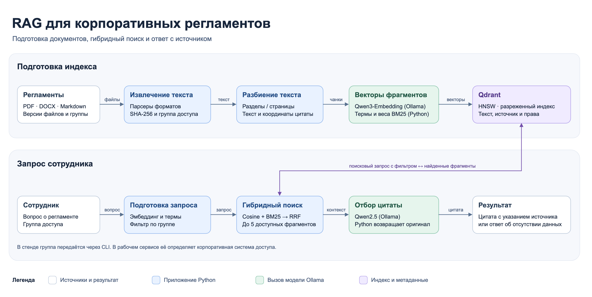

# Отчёт по практической № 2

## 1. Вариант и задача

| Поле | Значение |
| --- | --- |
| ФИО (как в VK Education) | Кабанов Дмитрий Вячеславович |
| Тема | Вариант 3. Поиск по документам с RAG и векторной БД |
| Состав решения | Python для загрузки и подготовки данных, Qwen3-Embedding и Qwen2.5 через Ollama, Qdrant для гибридного поиска |
| Данные и объём | Учебный корпус из 9 русскоязычных регламентов в Markdown, PDF и DOCX. Проектный сценарий — 5 000 файлов, около 100 000 фрагментов при среднем размере 20 фрагментов на документ. |

Сотрудник задаёт вопрос так, как сформулировал бы его коллеге, и получает короткую цитату с названием файла и номером страницы или заголовком раздела. Поиск должен понимать перефразированные вопросы и находить точные коды заявок. Документы подразделения доступны только его участникам. Когда в найденных документах нет подходящей цитаты, сервис сообщает, что ответ не найден.

## 2. Источники и способы сбора

| Источник | Тип | Способ сбора |
| --- | --- | --- |
| Справочник сотрудника | Markdown | Пакетная выгрузка из базы знаний. Заголовки определяют границы разделов, а путь позволяет открыть исходный документ. В стенде используется каталог `corpus/all`. |
| Утверждённые регламенты | PDF с текстовым слоем | Пакетная загрузка файлов. `pypdf` извлекает текст по страницам, поэтому к ответу можно приложить номер страницы. |
| Инструкции по оборудованию | DOCX | Пакетная загрузка. `python-docx` читает абзацы и заголовки, по которым можно найти цитату в документе. |
| Документы HR и ИТ | Markdown с группой доступа | В рабочем сервисе из системы документов берутся группы доступа. В стенде группу задаёт каталог `corpus/hr` или `corpus/it`. |
| Вопрос сотрудника | Запрос при обращении | В стенде запрос приходит через CLI. В рабочем сервисе приложение получает группы пользователя из корпоративной системы идентификации и доступа. |

Регламенты меняются отдельными редакциями. Для стенда достаточно пакетной сборки индекса по текущим файлам. В рабочем контуре изменения можно определять по версии или контрольной сумме, а обновление прав обрабатывать по событиям. Сканам нужен OCR с проверкой качества, а таблицам DOCX нужен отдельный разбор структуры.

## 3. Архитектура



[Редактируемый исходник draw.io](architecture.drawio)

Qdrant хранит текст и его метаданные рядом с двумя представлениями фрагмента. В плотном индексе фрагменты сравниваются по косинусной близости. Для масштабирования выбран HNSW с `m=16`, `ef_construct=100` и запрошенным `hnsw_ef=64`. По графу можно найти близких соседей, обходя часть коллекции. За это платим памятью, временем построения индекса и возможными пропусками. На небольшом корпусе Qdrant может использовать полный перебор. HNSW проверяется отдельно на большом корпусе сравнением с точным поиском по тем же векторам и фильтрам. Для 100 000 векторов по 1 024 значения float32 исходные плотные векторы займут около 391 МиБ. Граф, разреженный индекс, метаданные и запас на перестроение увеличат объём. [Документация индексов Qdrant](https://qdrant.tech/documentation/manage-data/indexing/)

Полнотекстовая ветка использует стемминг русских слов, сохраняет коды вроде `ACC-42` целиком и взвешивает термы по BM25. Python считает веса по частоте терма и длине фрагмента, Qdrant применяет IDF. Семантическая ветка ищет близкие по смыслу перефразировки. Reciprocal Rank Fusion (RRF) объединяет списки по позициям, потому что шкалы BM25 и косинусной близости различаются. Фильтр по группе применяется внутри обеих веток до отбора кандидатов, а также на итоговом запросе. [Гибридный поиск Qdrant](https://qdrant.tech/documentation/search/hybrid-queries/)

## 4. Docker

| Блок | Реализация |
| --- | --- |
| `app` | CLI для индексации, запроса и проверки качества. Извлекает текст из Markdown, PDF и DOCX, считает лексические признаки и подставляет оригинал выбранной цитаты. |
| `qdrant` | Qdrant 1.15.5. Плотный и разреженный поиск, фильтр по правам, переключение версии через alias. |
| `ollama` | Ollama 0.13.5. `qwen3-embedding:0.6b` строит эмбеддинги, `qwen2.5:1.5b` выбирает цитату. |
| Корпоративный контур | В проекте предусмотрены коннектор документов, синхронизация ACL и корпоративная аутентификация. В стенде их роль выполняют локальная папка и аргумент `--group`. OCR и парсинг таблиц оставлены в проектном контуре. |

Запуск из каталога с `docker-compose.yml`:

```bash
docker compose up -d --build
docker compose exec -T ollama ollama pull qwen3-embedding:0.6b
docker compose exec -T ollama ollama pull qwen2.5:1.5b
docker compose exec -T app python rag.py index
docker ps --filter label=com.docker.compose.project=pract2-rag --format 'table {{.Names}}\t{{.Image}}\t{{.Status}}'
docker compose exec -T app python rag.py ask 'Когда нужно вернуть ноутбук при увольнении?'
docker compose exec -T app python rag.py evaluate
docker compose exec -T app python rag.py verify
```

Файлы корпуса входят в образ приложения. После изменения файлов нужно пересобрать `app` и выполнить `index` ещё раз. Команда `docker compose down` останавливает стенд с сохранением данных и моделей в томах Docker.

Фактический вывод `docker ps` для проекта `pract2-rag` 25 ноября 2026 года.

```text
NAMES                 IMAGE                   STATUS
pract2-rag-app-1      pract2-rag-app          Up 43 seconds
pract2-rag-qdrant-1   qdrant/qdrant:v1.15.5   Up 20 minutes
pract2-rag-ollama-1   ollama/ollama:0.13.5    Up 20 minutes
```

При запуске Docker Desktop не разрешил DNS-имя `registry.ollama.ai` из контейнера, и `ollama pull` завершился ошибкой. Для этого прогона скачал файлы тех же моделей из официального реестра с хоста, проверил SHA-256 всех слоёв и скопировал файлы в том Ollama. Модели хранятся локально, в репозиторий входят только исходники и учебный корпус.

Индексация завершилась успешно. Алиас `regulations` указывает на новую коллекцию с 22 фрагментами из 9 документов.

```json
{"documents": 9, "chunks": 22, "collection": "regulations_f36ea4853b5d", "vector_size": 1024, "alias": "regulations", "indexed_vectors": 22}
```

## 5. Путь данных и проверка качества

| Стадия | Что происходит | Результат |
| --- | --- | --- |
| Ingestion | Пакетный загрузчик извлекает текст, записывает путь, SHA-256 содержимого и группу. Файл без извлекаемого текста останавливает сборку, чтобы ошибку было видно. | Текст известной версии с указанием источника и прав. |
| Chunking | DOCX и Markdown делятся по заголовкам, PDF — по страницам. Длинные разделы разбиваются на фрагменты до 1 000 символов по границам слов с перекрытием до 140 символов. | Фрагменты с номером, страницей или заголовком. Перекрытие сохраняет часть контекста у границ. |
| Embedding | Qwen3-Embedding кодирует текст с заголовком раздела. Python параллельно формирует разреженный вектор термов. Новая коллекция заполняется до переключения alias `regulations`. Удалённый файл исчезает из активной коллекции при следующей сборке. | Готовый индекс с эмбеддингами, термами, исходным текстом и метаданными. Предыдущая коллекция остаётся доступной оператору для отката. |
| Векторный и полнотекстовый поиск | Запрос кодируется той же моделью. Qdrant получает до 20 кандидатов из каждой ветки, применяет фильтр по группе и объединяет ранги через RRF. | До пяти доступных фрагментов для модели. |
| Генерация ответа | Python оставляет фрагменты с косинусным сходством не ниже 0,45 и отставанием от лучшего фрагмента не больше 0,15. Затем нумерует предложения. Qwen2.5 возвращает номер подходящего предложения или 0. Python проверяет номер и возвращает исходное предложение с метаданными. | Дословный ответ с источником или сообщение об отсутствии ответа. Уместность цитаты проверяется отдельно. |

Проверка поиска отделена от проверки генерации. Набор включает 13 вопросов с размеченными источниками и разделами. Есть точный код, разговорные формулировки, закрытые документы для уполномоченной группы и два вопроса с двумя релевантными разделами. На одном корпусе сравниваются плотный поиск, BM25 и RRF. Recall@5 — средняя доля релевантных разделов среди первых пяти фрагментов. MRR@5 — среднее обратное место первого релевантного раздела. Одинаковые разделы в выдаче учитываются один раз. Время — медиана по запросам после прогрева модели с учётом построения эмбеддинга там, где он нужен. [Размеченные вопросы](eval_cases.json)

Результаты прогона поиска:

| Режим | Recall@5 | MRR@5 | Медиана, мс |
| --- | ---: | ---: | ---: |
| Плотный | 1,0000 | 1,0000 | 553,1 |
| BM25 | 0,7692 | 0,6923 | 0,9 |
| Гибридный RRF | 1,0000 | 0,8462 | 483,7 |

Плотный и гибридный режимы нашли все размеченные разделы в первой пятёрке. Плотный поиск поставил первый релевантный раздел на первое место во всех 13 вопросах. В четырёх вопросах RRF опустил его на второе место. У BM25 три полных пропуска пришлись на перефразировки, например про «потерянную карточку для входа» вместо «утраты пропуска». На этом корпусе гибридный поиск сохранил полноту плотного, но уступил ему в ранжировании. Сравнение задержек ориентировочное, так как режимы запускались последовательно на одном компьютере.

Сценарии ответа проверяют цитату из PDF и DOCX, ответ для разрешённой группы, недоступность закрытого документа и отказ на вопрос вне корпуса. В первом прогоне модель выбрала посторонние цитаты в двух вопросах без доступного ответа. Максимальное косинусное сходство по ним составило 0,407 и 0,325. Я выставил порог 0,45. Уместные фрагменты в поисковой разметке получили более высокий балл. Этот порог подобран для учебного корпуса и применяется только перед генерацией. Модель также изменила формулировку цитаты из PDF. После этого я перевёл генерацию на выбор номера предложения, чтобы текст выдавался прямо из документа. [Сценарии ответа](verify_cases.json)

**Итог сквозного прогона — 5 из 5 сценариев.** Для PDF найден код `SEC-17` на первой странице, для DOCX — срок возврата ноутбука, для группы `it` — срок выдачи административных прав. В запросе к закрытому материалу HR для группы `all` в результатах поиска не было закрытых фрагментов. В этом запросе и в вопросе вне корпуса стенд вернул «Ответ не найден в доступных документах».

Пример ответа из прогона:

> При увольнении ноутбук и зарядное устройство возвращают в сервисную зону в последний рабочий день.

Источник — `all/equipment.docx`, раздел «Возврат оборудования».

Для рабочего контура потребуется калибровка порога на независимой разметке реальных вопросов. На ней можно измерить долю уместных цитат, корректность отказов и задержку p95. Для оценки HNSW и готовности к рабочей нагрузке нужны тесты на проектном объёме.

### Роль инженера данных

Инженер данных отвечает за загрузку документов, контроль версий, качество извлечения текста, схему метаданных, актуальность прав, сборку индекса и метрики поиска. Предметные эксперты определяют действующие версии регламентов и размечают релевантность. Команда приложения и ML отвечает за пользовательский интерфейс, выбор модели генерации и оценку полноты ответа. Смена модели эмбеддингов требует пересчитать весь плотный индекс, потому что старые и новые векторы нельзя сравнивать в одном пространстве.

## 6. Выводы

В этой задаче эмбеддинги помогают сопоставлять разговорный вопрос с текстом регламента, а полнотекстовая ветка учитывает коды и названия. Плотный режим оказался лучшим по ранжированию на нашем корпусе. Гибридный режим оставил в стенде, чтобы показать работу обеих веток и сравнить их. Перед выбором режима для рабочей системы проверил бы его на большем наборе вопросов с кодами и перефразировками.

Сотрудник может сразу проверить правило по цитате с указанием файла и раздела. Для этого нужно поддерживать актуальность текста и прав доступа на всём пути от исходного документа до ответа.

### Документация

- [Описание варианта и требования к работе](https://github.com/m1705161/p2)
- [Ollama API для эмбеддингов](https://docs.ollama.com/api/embed)
- [Ollama API для структурированного ответа](https://docs.ollama.com/api/chat)
- [Семейство моделей Qwen3-Embedding](https://ollama.com/library/qwen3-embedding)
